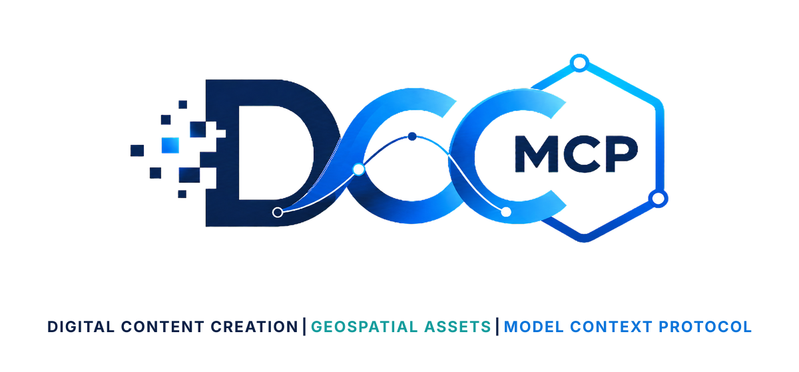
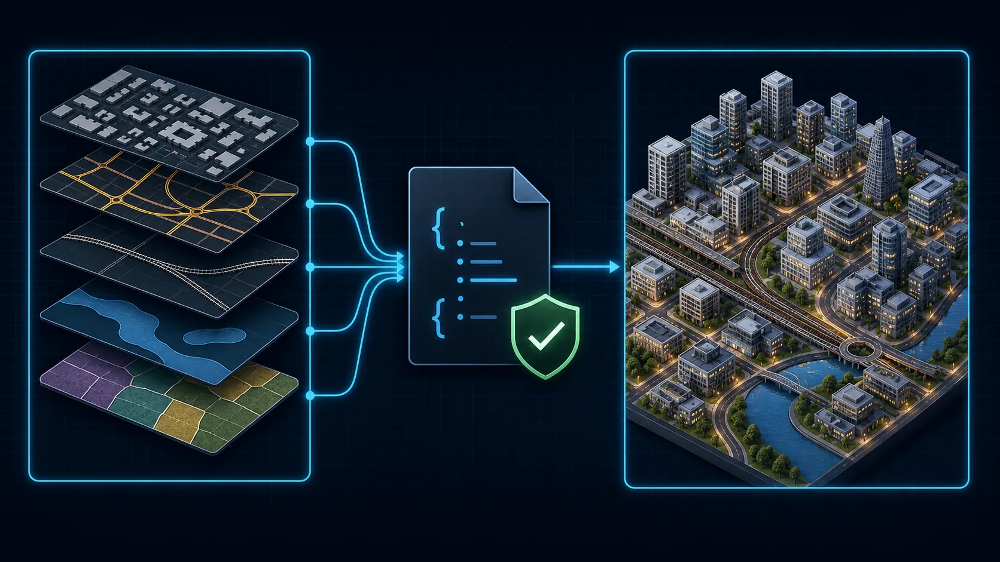
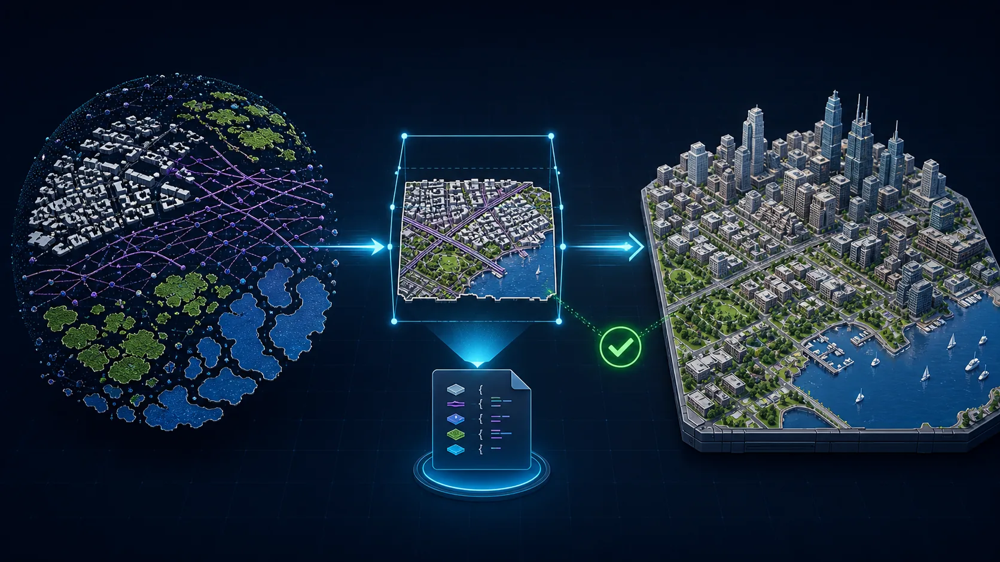

# DCC-MCP Geospatial Assets

<p align="center">
  
</p>

## Agent workflow

AI agents should use installed package skills through the shared gateway. IDE
users may continue to use the MCP endpoint.

### Install or update the CLI

`dcc-mcp-cli` is the preferred control path for every shell-capable agent. If
it is missing, ask the user before installing the latest official release:

Download the installer as a local file, inspect it, and then run it under the
machine's current script execution policy:

```bash
# Linux/macOS
curl -fL https://raw.githubusercontent.com/dcc-mcp/dcc-mcp-core/main/scripts/install-cli.sh -o install-cli.sh
cat install-cli.sh
# After reviewing the file:
sh ./install-cli.sh
```

```powershell
# Windows PowerShell
Invoke-WebRequest https://raw.githubusercontent.com/dcc-mcp/dcc-mcp-core/main/scripts/install-cli.ps1 -OutFile .\install-cli.ps1
Get-Content -Raw .\install-cli.ps1
# After reviewing the file and subject to the current execution policy:
& .\install-cli.ps1
```

Keep an official build current through the release manifest:

```bash
dcc-mcp-cli update check
# Only after the user explicitly agrees to the update:
dcc-mcp-cli update apply --yes
```

`update apply` downloads and stages the latest CLI for the next launch. It
does not update a running `dcc-mcp-server`; update that server in its own
environment.

Choose one stable `<task-id>` for the task and pass `--require-gateway` and
`--agent-session-id` to every tool call that needs task statistics. The gateway
retains the calls for audit and stats; `--agent-session-id` sets
`_meta.agent_context.session_id`. Reuse the same ID in `stats --session-id`
after the task.

```bash
dcc-mcp-cli dcc-types
dcc-mcp-cli list
dcc-mcp-cli search --query "<task>" --dcc-type <host>
dcc-mcp-cli describe <tool-slug>
dcc-mcp-cli call <tool-slug> --require-gateway --agent-session-id "<task-id>" --json '{"key":"value"}'
```

If the package skill is not active, call
`dcc-mcp-cli load-skill <skill-name> --dcc-type <host>`. After the task,
query `dcc-mcp-cli stats --range 24h --session-id "<task-id>"` and pass only
bounded evidence to the `review_skill_improvement` prompt from
`dcc-mcp-skills-creator`.


DCC-neutral providers for downloading city-scale geospatial data for Houdini, Blender, Unreal,
and other procedural content workflows.

- `openstreetmap-city-data` queries a bounded OpenStreetMap area through Overpass and writes
  buildings, roads, railways, water, and land use to GeoJSON.
- `overture-city-data` wraps the official Overture Maps client for bounded GeoJSON extracts of
  buildings, transportation, infrastructure, land, land cover, and water.

Every download returns a validated `AssetDescriptor` with the source URL, data license, required
attribution, requested bounds, and local file. These skills download data only; projection,
extrusion, terrain conformation, and scene import belong to the target DCC skill.

## Showcases

### OpenStreetMap city data



### Overture city data



These are original workflow illustrations; no map tiles, provider logos, or product interfaces are
reproduced.

See [geospatial data source coverage](docs/data-source-candidates.md) for terrain, land-cover, bulk
OpenStreetMap, and regional follow-up providers.

## Validate

```bash
python tests/smoke_test.py
```
